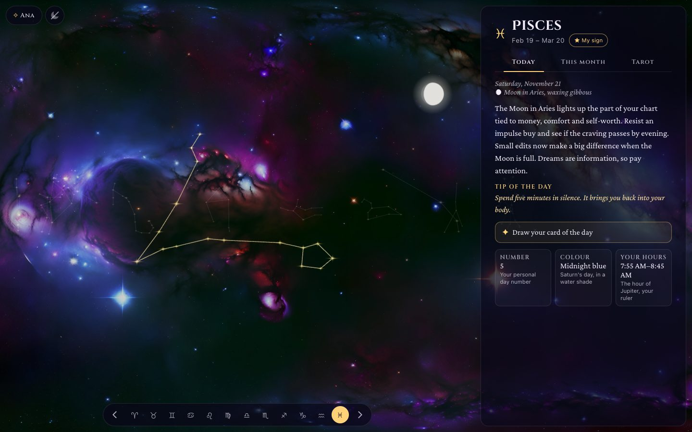
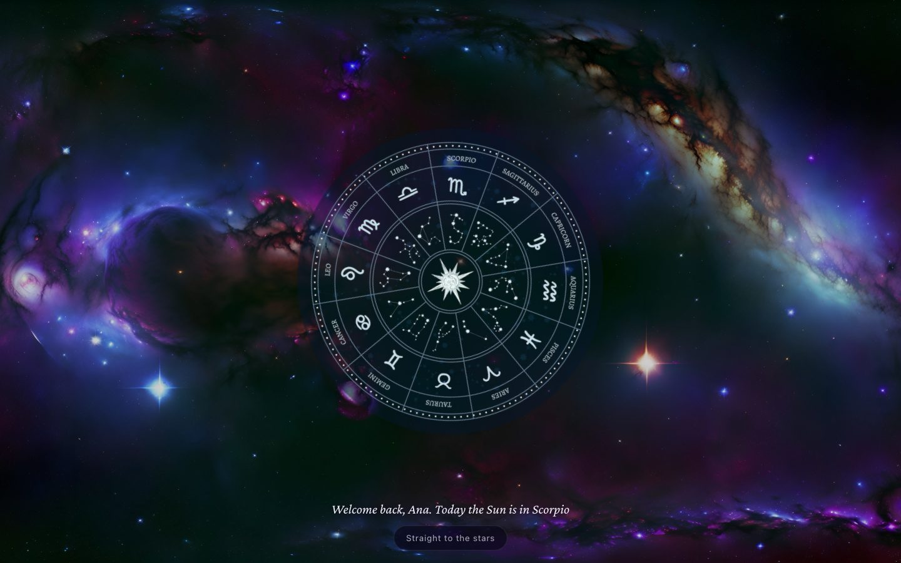
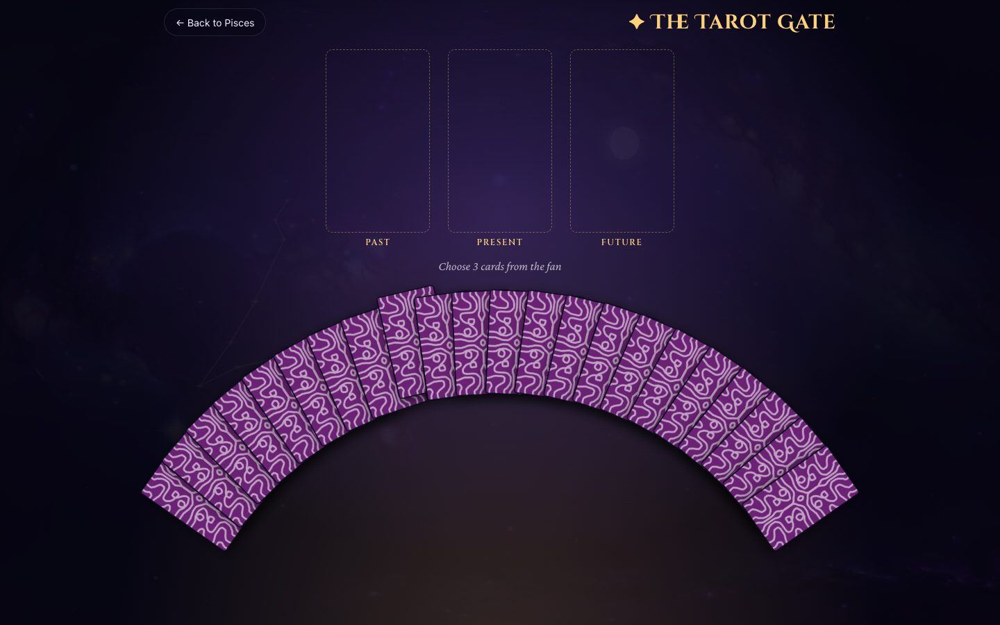
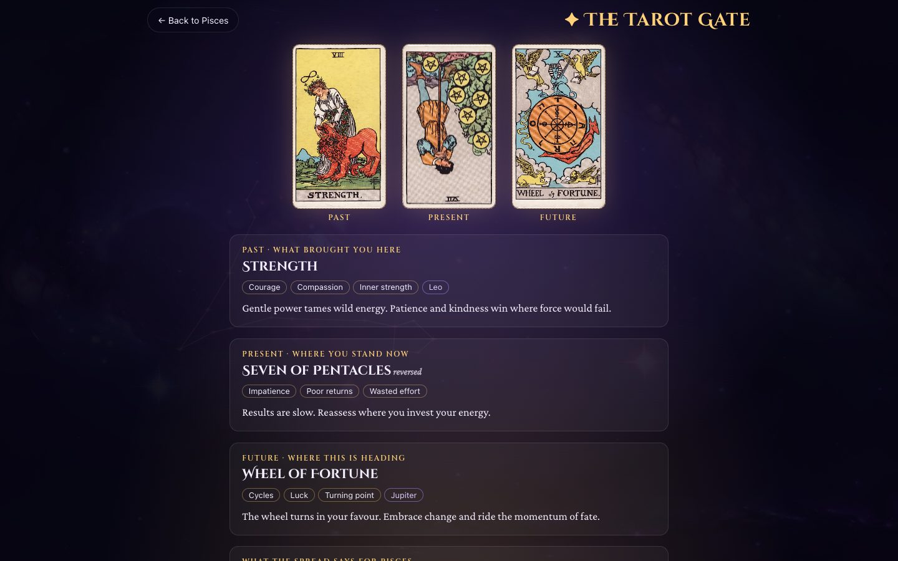
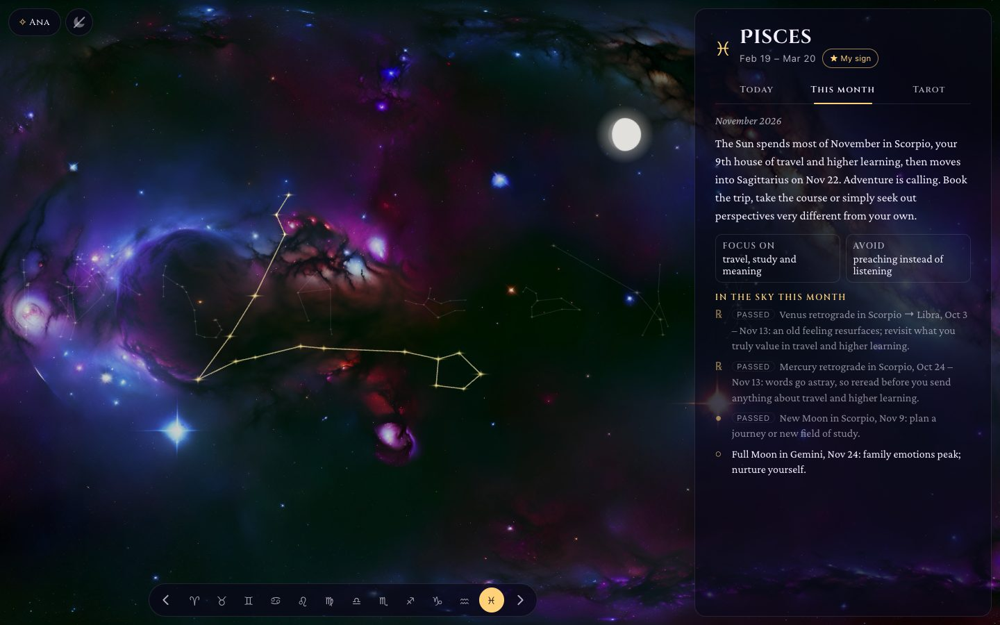
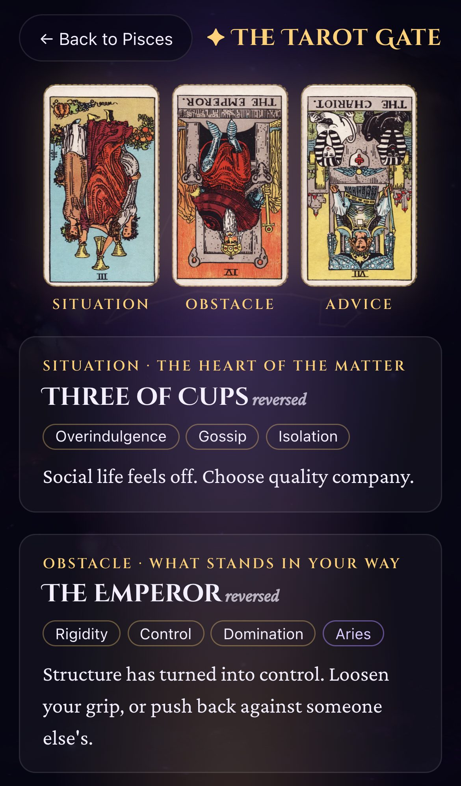
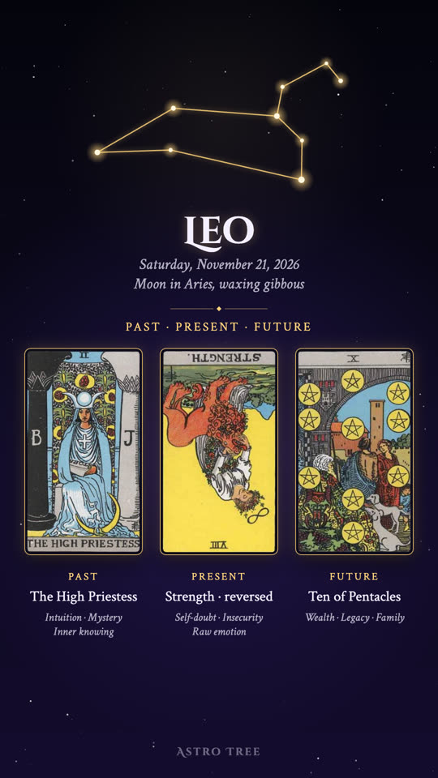

# Astro Tree

**A night-sky horoscope and tarot ritual.** The twelve zodiac constellations hang in a real 3D sky drawn from actual
star positions. Every sign gets a reading for today and this month, worked out from where the Sun, Moon and planets
really are. When it's time for a question, the Tarot Gate opens on the full 78-card deck.

**Live:** [astro-tree.vercel.app](https://astro-tree.vercel.app) · installable on phones as an app (Add to Home Screen)



| The wheel lands on today's sign | Pick your cards from the fan | Turn them over, one by one |
| --- | --- | --- |
|  |  |  |

| This month's sky | On a phone | Keep the reading |
| --- | --- | --- |
|  |  |  |

## What's inside

- **A real sky.** All twelve constellations are built from J2000 star coordinates, with stars sized by brightness.
  - Drag to orbit and pinch to zoom.
  - The sign you pick turns to face you.
  - Today's Moon hangs over the constellation it's passing through, drawn at its real phase.
- **A ritual to open it.** A zodiac wheel spins, glides to rest on today's sign and rings like a singing bowl; then
  you brush the stardust aside.
- **Readings from the real sky.**
  - **Today:** built from the Moon's actual sign and phase, counted as a house from your sign (or your rising),
    with a headline on days when the Moon is new or full, the Sun changes sign or a planet stations retrograde.
  - **This month:** the Sun's house, the new and full moons, and any Mercury, Venus or Mars retrograde,
    each marked passed, now or upcoming.
- **Lucky values that follow real systems.**
  - Number: numerology (your personal day number if you've given your birthday).
  - Colour: the weekday's ruling planet.
  - Your hours: the planetary hour of your sign's ruler.
- **The Tarot Gate.** Choose a spread (card of the day, past/present/future, situation/obstacle/advice), then:
  1. Hold the deck to shuffle it, and cut it into three piles.
  2. Pick cards from the fan.
  3. Turn each card over yourself.

  The reading combines upright or reversed meanings with notes for your sign. The card of the day is kept until
  tomorrow, your recent ones collect in a strip, and any reading can be saved or shared as an image.
- **It remembers you.**
  - Your sign, name, birthday and rising stay on your device.
  - Your constellation is traced in gold, and the intro greets you by name.
- **Works everywhere.**
  - Side panel on landscape screens, bottom sheet on portrait ones.
  - Touch-first, safe-area aware, works offline once installed.
  - Readings still work without WebGL.

More detail and the idea backlog: [docs/FEATURES.md](docs/FEATURES.md).

## How the readings are made

Nothing is fetched from a horoscope service. [`src/lib/ephemeris.ts`](src/lib/ephemeris.ts) computes positions on the
device:

- Sun and Moon from Meeus, *Astronomical Algorithms*.
- Mercury, Venus and Mars from JPL's Keplerian elements.

The tests check it against published events:

- the 2025 new and full moons land within about an hour;
- the equinox and solstices match;
- Mercury's and Venus's retrograde stations land within a day or two.

The wording is original and hand-written ([`src/data/horoscope/`](src/data/horoscope)). Each sentence rotates through
its own pool, so:

- no sentence returns within 11 days;
- a full reading doesn't repeat for 1,848 days;
- tips don't repeat for over three years.

The tarot deck ([`src/data/tarot.ts`](src/data/tarot.ts)) has all 78 Rider–Waite–Smith cards with upright and
reversed meanings.

Want the readings as a file? `npm run export:readings -- 2026 3` writes every daily and monthly reading to `dataset/`.
The CSVs for 2026–2028 are committed.

## Run it

```sh
npm install
npm run dev        # http://localhost:3000 (add ?intro=off to skip the intro)
npm test           # ephemeris, readings, tarot, numerology, keepsake, sound
npm run build && npm run preview
```

Arrow keys move between signs; Escape closes a card or the gate.

## Docs

| | |
| --- | --- |
| [Features & ideas](docs/FEATURES.md) | Everything that's built, plus what could come next |
| [Architecture](docs/ARCHITECTURE.md) | How the code is organised and how the readings, sky and gate work |
| [Shipping as an app](docs/SHIPPING.md) | PWA today; App Store and Play Store options, costs and checklists |
| [Credits](docs/CREDITS.md) | Card art, fonts and data sources |

Built with React, React Three Fiber, framer-motion, Vite and TypeScript. Deployed on Vercel.
